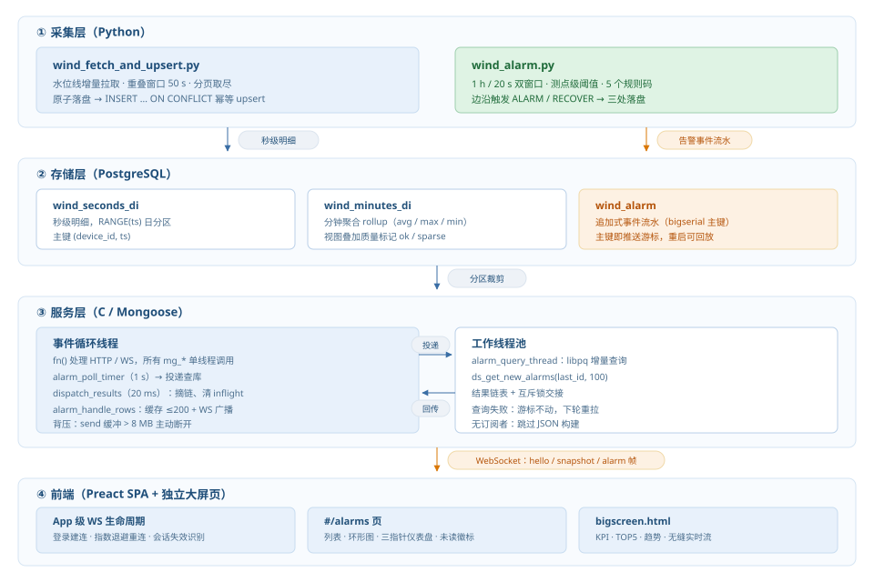
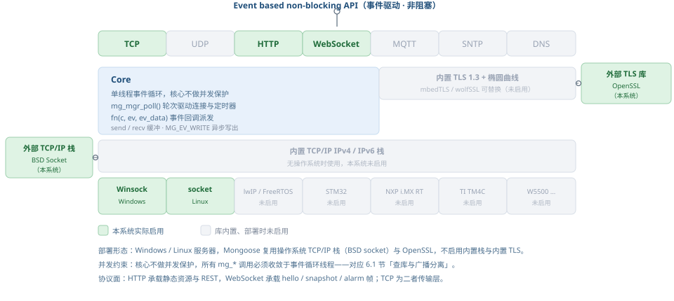
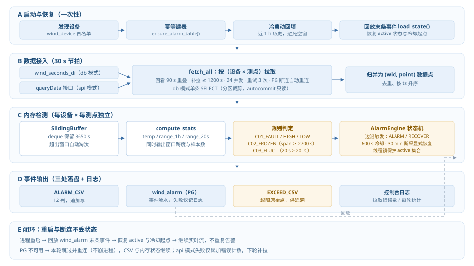
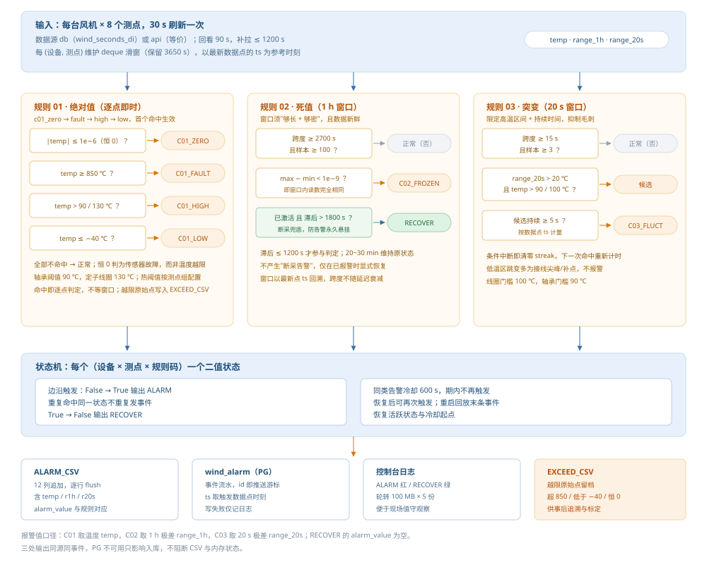
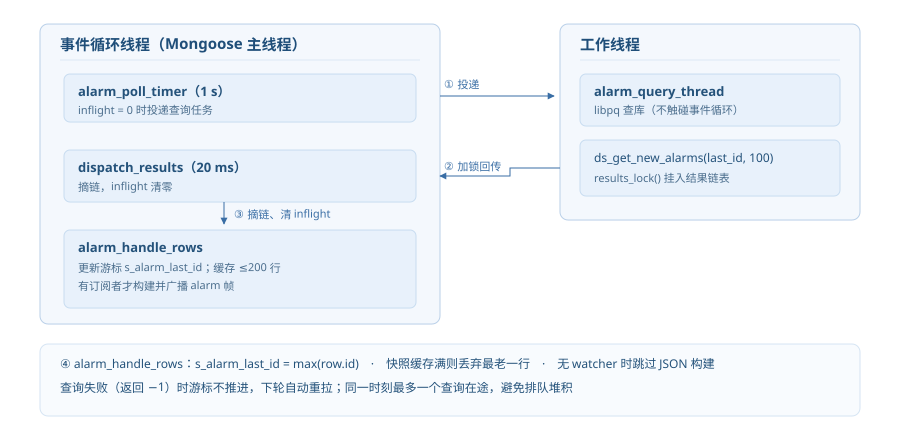
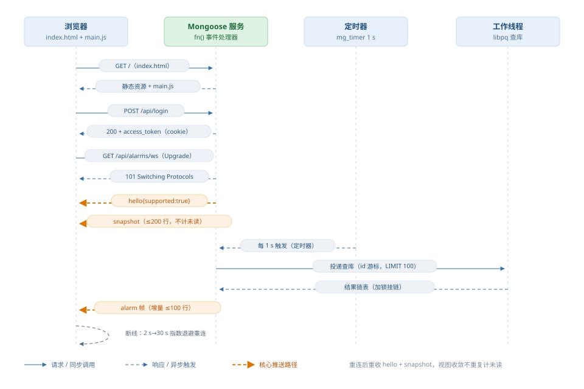

# 风电机组发电机轴承温度特性分析与故障预警

## ——面向场站侧的秒级采集、多规则检测与实时推送系统

**摘要**：发电机轴承温度是反映风电机组传动链健康状态的核心测点，其变化同时具有"工况耦合、热惯性平滑、故障渐变累积、失效瞬间突变"的多重特征：润滑不良与冷却失效表现为基线缓慢漂移，轴承点蚀与异物进入可在数十秒内造成温度跳变，而传感器死值、超量程与接线尖峰则不体现为真实温升，却同样会污染监测结论。针对上述特性，本文设计并实现了一套面向场站侧的轴承温度故障预警系统。系统以 Python 采集端的水位线（watermark）机制对源接口做增量拉取，基于 PostgreSQL 日分区表实现秒级数据的高吞吐幂等写入与分钟级 rollup；检测引擎为每台机组、每个测点维护 1 h 与 20 s 两级滑动窗口，按测点分组配置阈值，执行绝对值越限、死值校验与短窗突变三类规则（拆分为 5 个规则码），并针对断采导致的"假死值"给出防抖（方案 B）语义；告警以追加（append-only）事件流水落库，以自增主键同时充当审计档案、推送游标与状态恢复源；服务端在 C 语言与 Mongoose 嵌入式 Web 库之上复用 RFC 6455 协议栈，通过"定时器投递—工作线程查库—事件线程分发"的异步协作把数据库 I/O 移出网络事件循环，并配合动态帧预算、非有限值过滤、UTF-8 安全截断与发送缓冲背压保障推送链路稳定；前端以 Preact 单页应用承载应用级 WebSocket 生命周期、指数退避重连、会话失效识别与未读徽标，并提供类型环形图、三指针仪表盘与独立值守大屏三种同源可视化。测试表明，系统分组自动化回归（WebSocket 契约与健壮性 41 项、告警推送专项 34 项、接口与推送全量回归 45 项）与浏览器端到端验证全部通过，告警从落库到前端呈现的端到端延迟稳定低于 2.5 s。与 SCADA 集控、数据驱动状态监测研究与 IoT 云平台三类方案相比，本系统的定位是"秒级、可恢复、低依赖"：以事件流水与自增游标统一审计、推送与状态恢复，以单进程服务 + 单库替代消息中间件，并把死值与突变提升为与越限并列的一等检测规则，从而覆盖传感器失效与短时冲击这类阈值规则天然漏检的场景。

**关键词**：风电机组；发电机轴承；温度特性；故障预警；WebSocket；滑动窗口；PostgreSQL 分区表；事件驱动架构

---

## 1 引言

### 1.1 研究背景与意义

发电机轴承是风电机组传动链中失效概率较高的部件之一。轴承一旦失效，轻则触发停机损失发电量，重则造成发电机扫膛、轴系损伤等高成本事故。轴承温度作为最直接、最廉价的状态量，长期被用于现场巡检与 SCADA 监视，但其工程价值长期受限于两点：一是采样与展示的时效不足，二是判定逻辑停留在固定阈值，难以区分"设备真的热了"与"测点坏了"。

从热力学角度看，轴承温度是损耗发热与散热平衡的结果，受机组功率、风速、环境温度、润滑状态与冷却条件共同影响，具有明显的一阶惯性；从故障演化角度看，润滑失效、冷却堵塞属于渐变型故障，点蚀、异物、保持架损伤则可能表现为短时突变；从测量角度看，PT100 探头断线、短路、老化会输出固定值或超量程码，接线松动与电磁干扰会制造秒级尖峰。三类特征的时间尺度相差数个数量级，任何单一阈值的判定都必然在其中某一类上失效。

传统监控界面多采用 HTTP 轮询刷新告警列表，存在三类固有缺陷：

1. **延迟不可控**：轮询间隔与告警发生时刻的相位差，使告警呈现延迟在 0 到一个轮询周期之间波动；
2. **无效负载高**：无告警时段的轮询绝大多数返回空结果，服务端仍需执行完整查询；
3. **状态不连续**：页面切换、多标签页并行时轮询状态彼此独立，难以维护统一的"未读"语义。

WebSocket 协议（RFC 6455）提供了全双工、低开销的持久通道，是解决上述问题的主流方案。但将实时推送嵌入一个以 C 语言实现的嵌入式 Web 服务，并保证其在数据库抖动、连接中断、服务重启下仍然可靠，仍需系统性的架构设计。

### 1.2 相关工作

围绕轴承温度的状态监测与故障预警，既有工作大致分为三类。第一类是**温度特性与机理分析**：通过统计正常运行数据，刻画轴承温度与环境温度、功率、风速的关系，提取温升、温差、变化率等特征用于预警[6]。第二类是**数据驱动模型**：以 SCADA 数据训练回归、神经网络或 CNN-LSTM-Attention 等模型，构建正常行为基线，以残差或健康度判定异常[7-10]。第三类是**集控与云平台工程方案**：以实时库、组态软件或 MQTT + 时序数据库构建全场/区域级监视，强调接入规模与分级报警[11]。

三类工作各有侧重：机理分析给出"看什么特征"，数据驱动给出"如何建模"，工程方案给出"如何落地"。但在场站侧的实际约束下——网络受限、运维力量薄弱、不允许引入重型中间件——还需要一套能把秒级数据、多规则判定与可靠推送串起来的轻量实现。这正是本文的工作。

### 1.3 本文工作与贡献

本文以某风电场风机秒级监控项目为背景，围绕发电机轴承温度特性，完成从数据采集到前端呈现的全链路设计与实现，主要贡献包括：

- 归纳了轴承温度的四类可计算特征（绝对温度、短窗极差、长时间不变、超量程/非法值），并据此推导出"秒级保留 + 双时间尺度窗口 + 状态化告警"的监测需求；
- 提出"水位线增量拉取 + 分区表幂等写入"的数据底座方案，保证 at-least-once 语义下的数据一致性；
- 设计了基于 1 h / 20 s 双窗口的多规则检测引擎，给出测点级阈值参数化与 5 个规则码的边沿触发状态机，并给出死值校验在断采场景下的防抖（方案 B）语义；
- 提出可与现有事件流对接的预警模型扩展设计：以工况归一化残差、多测点一致性与无监督/有监督异常检测，将固定阈值升级为"事前预警"；
- 实现了 C 端"定时器投递—工作线程查库—事件线程分发"的异步推送架构，使数据库 I/O 与网络事件循环解耦；
- 给出了基于 Mongoose 内置 RFC 6455 协议栈的服务端实现方案，涵盖升级约束、连接标记、帧预算、序列化边界与背压控制；
- 定义了 hello/snapshot/alarm 三段式推送协议与"快照不计数、进页清零"的未读徽标语义；
- 设计了与列表同源的环形图、三指针仪表盘及独立大屏视图，提出"单端点、多连接、服务端扇出"的多视图订阅模型；
- 建立了契约断言、健壮性断言与浏览器验证三级回归体系，并以 75 项 + 45 项自动化断言固化关键行为。

---

## 2 发电机轴承温度特性分析

### 2.1 测点布置与信号链路

发电机温度监测通常覆盖三类测点：**驱动端轴承温度**、**非驱动端轴承温度**与**定子绕组温度**。驱动端靠近联轴器与齿轮箱侧，承受较大的径向载荷与轴向定位力，其稳态温升通常高于非驱动端；非驱动端主要承受转子自重与电磁不平衡力；绕组温度则主要反映铜耗与绝缘状态。系统以测点编码区分：`TEMGENDRIEND`（驱动端）、`TEMGENNONDE`（非驱动端）、`TEMGENSEN1/2/3`（定子三相绕组）以及 `TEMGENSTAU/V/W`（第二组/备用绕组）。

传感器多为三线制 PT100 铂电阻，经采集器以秒级周期采样后上送平台。完整信号链包含"探头—采集器—通信—平台"四段，任一段异常都可能表现为"温度异常"：探头断线可能输出超量程码，采集器故障会造成整段死值，通信中断会造成数据缺口，平台侧则表现为时间戳滞后或采样稀疏。因此，监测系统必须能够区分"设备热异常"与"测点/链路异常"，这是后文死值校验与突变规则的设计依据。

### 2.2 温度的工况耦合与热惯性

轴承温度不是独立变量，而是损耗发热与散热平衡的结果：发热主要来自滚动体与滚道的摩擦损耗、润滑脂的剪切损耗；散热依赖机舱通风、冷却系统与环境温度。稳态温度可近似表示为环境温度、机组功率（或风速）与冷却条件的函数。工程上常以**温升**（测点温度减环境温度）而非绝对温度表征轴承状态，以削弱环境温度的季节性影响[6]。

温度对负载的响应具有明显惯性，可用一阶惯性环节近似：

```
T(t) = T0 + ΔT · (1 − e^(−t/τ))
```

其中时间常数 τ 通常为分钟级。由此可得两条重要推论：

1. 短时阵风引起的温升会被热惯性平滑，秒级毛刺不一定代表设备异常，判定需要"持续时间"约束；
2. 润滑失效、冷却堵塞引起的温升是持续累积的，其识别依赖较长窗口内的基线漂移；而点蚀、异物等突发故障可在数十秒内造成跳变，必须在短窗口内捕捉。

因此，**"渐变"与"突变"必须用不同时间尺度的窗口分别观测**，这是本文双窗口设计的物理依据。

### 2.3 典型故障的温度特征

| 故障类型 | 温度表现 | 时间尺度 | 可计算特征 |
|----------|----------|----------|------------|
| 润滑不良/润滑脂老化 | 基线缓慢抬升，温升增大 | 小时—天 | 绝对温度、长窗趋势 |
| 轴承磨损、点蚀、保持架损伤 | 台阶式上升或周期性波动 | 分钟—小时 | 绝对温度、短窗极差 |
| 冷却/通风失效 | 快速上升，常高于同类机组 | 十分钟—小时 | 绝对温度、变化率 |
| 传感器断线/短路/老化 | 固定值（死值）、超量程码（850/−40） | 持续 | 1 h 极差为 0、量程判定 |
| 接线松动/电磁干扰 | 秒级尖峰，随后恢复 | 数秒 | 短窗极差、持续时长 |

由上表可见，前三类属于"真实热异常"，后两类属于"测点异常"。若仅使用绝对阈值，后两类中只有超量程会被捕获，死值与小尖峰则完全漏检；若仅使用变化率，渐变型故障又会被平滑掉。这正是本文把绝对值、死值、突变并列为三条独立规则的直接原因。

### 2.4 对监测系统的需求推导

基于上述特性，系统需满足五项需求：

1. **秒级原始值保留**：分钟级平均会抹平 20 s 级突变，原始秒级数据必须落库；
2. **多时间尺度窗口**：1 h 窗口用于死值判定与趋势观察，20 s 窗口用于突变与极差计算；
3. **状态化告警**：必须同时输出 ALARM 与 RECOVER 两类事件，否则告警会"一直响"而失去指示意义；
4. **测点语义可视**：驱动端、非驱动端、绕组需在界面上可区分，便于运维快速定位；
5. **工况关联能力**：阈值应能随功率/环温调整；本文当前版本以固定阈值起步，并将其列为后续改进方向。

---

## 3 系统总体架构

系统由四个层次构成，各层之间通过明确的契约解耦（见图 1）：

<p align="center"></p>

<div align="center">图 1  系统总体架构</div>

架构设计遵循三条原则：

- **单向依赖**：前端只依赖服务层协议，服务层只依赖数据库契约，检测层与推送层互不感知；
- **追加不可变**：`wind_alarm` 表只追加不更新，每条 ALARM/RECOVER 事件独立成行，天然构成事件流（event stream）；
- **游标单调**：一切增量消费（含推送）以自增主键 `id` 为游标，消费端崩溃重启后从上次游标（或库中末条 `id`）续拉即可重建状态。

技术选型上，采集与检测使用 Python（`psycopg2`、`requests`），存储使用 PostgreSQL 12+ 的原生分区表，服务端使用 C + Mongoose + libpq，前端使用 Preact 10 + htm 的免构建 ES Module 方案与 ECharts 5.6.1，样式使用预编译 Tailwind CSS。选型原则是"依赖尽可能少、单机即可运行"：除 Python 运行时与 PostgreSQL 外，不需要 Node 构建链、消息中间件或时序数据库。

服务端的网络框架选用 Cesanta 开源的 **Mongoose** 嵌入式网络库。它以单文件 `mongoose.c` / `mongoose.h` 形式分发，无任何外部依赖，内置 HTTP/1.1、TLS、WebSocket（RFC 6455）、MQTT、DNS 等协议栈，采用 `struct mg_mgr` 事件管理器、`struct mg_connection` 连接对象与 `mg_timer` 定时器组成的事件驱动模型：应用只需注册统一的事件回调 `fn()`，在 `MG_EV_*` 事件中处理连接建立、读写与协议消息，底层 I/O 由库内的非阻塞轮询完成。该项目自 2004 年起持续迭代，采用 GPLv2 与商业双许可[3]。选择它的原因有三点：其一，可在 Windows/MinGW、Linux 与嵌入式环境间直接交叉编译，与场站侧"单可执行文件"的部署形态一致；其二，HTTP 静态资源、REST 接口与 WebSocket 推送共用同一个监听端口与事件循环，无需额外 Web 容器；其三，协议栈成熟且体积小，握手、分片、Ping/Pong 等细节无需自行实现，使团队可以把精力集中在业务语义（告警状态机、增量游标、背压）上。

从协议栈位置看，Mongoose 属于"应用协议层 + 事件框架"，其下方既可复用操作系统自带的 TCP/IP 栈，也可启用库内置的 TCP/IP 栈与网卡驱动；TLS 同样支持内置实现或 OpenSSL/mbedTLS/wolfSSL。本系统部署在 Windows/Linux 服务器上，采用"BSD socket + 系统 TCP/IP 栈 + OpenSSL"的形态，Mongoose 只承担 HTTP/WebSocket 的解析与事件分发。图 2 借鉴官方分层架构，自上而下展开协议、Core、TLS、TCP/IP 与网络接口五层，并以绿色标出本系统实际启用的路径（图 2，依官方架构说明绘制[3]）。其核心是单线程的：`mg_mgr_poll()` 每轮遍历 `mg_connection` 链表，完成新连接接受、socket 非阻塞读写、关闭清理，并驱动到期定时器与协议处理器 `pfn`；每条连接持有独立的 `recv` / `send` 缓冲，发送 API 只把数据追加到 `send`，真正的 socket 写出发生在后续轮次。这一模型解释了本文后续两个关键设计：一是所有 `mg_*` 调用必须收敛在同一线程（官方文档明确核心不做并发保护），因此数据库查询被移出事件线程；二是慢客户端会让 `send` 缓冲持续增长，必须显式背压。

<p align="center"></p>

<div align="center">图 2  Mongoose 在协议栈中的位置与单线程事件循环</div>

---

## 4 数据采集与存储实现

### 4.1 水位线增量拉取

采集端（`wind_fetch_and_upsert.py`）以时间范围参数 `ts` 对源接口做增量拉取，水位线持久化于本地 `fetch_watermark.json`（格式 `{"fjmjsj": "YYYY-MM-DD HH:MM:SS"}`）。为保证 at-least-once 语义，设计包含四个要点：

1. **重叠窗口**：每轮拉取窗口向前回退固定秒数（默认 50 s），覆盖迟到与补传数据；
2. **分页取尽**：窗口内数据量未知时按 `PAGE_SIZE` 循环拉取直至响应 `total` 取尽，不假设单次返回全部；
3. **窗口上限**：单窗口跨度不超过 3600 s，防止单请求数据量失控；首次运行仅回填最近 5 分钟；
4. **原子落盘**：水位线写入采用临时文件 + `os.replace` 原子替换，杜绝半写文件。

拉取到的数据先按 `(device_id, ts)` 归并（设备 id 统一小写），再以 `execute_values` 批量 `INSERT ... ON CONFLICT (device_id, ts) DO UPDATE` 写入。主键约束保证同一设备同一时间戳仅一行，重叠窗口造成的重复数据被幂等吸收，实现了"至少一次拉取 + 恰好一次落库"的组合语义。

### 4.2 分区表设计

秒级明细表 `wind_seconds_di` 按时间做 RANGE 日分区：

```sql
CREATE TABLE wind_seconds_di (
  device_id text NOT NULL,
  ts        timestamptz NOT NULL,
  tem_gen_driend  float8,
  tem_gen_nonde   float8,
  tem_main_bearing float8,
  other_points    jsonb,
  PRIMARY KEY (device_id, ts)
) PARTITION BY RANGE (ts);
```

关键工程决策包括：

- **分区裁剪**：所有查询携带 `ts` 范围条件，使 PostgreSQL 借助分区裁剪只扫描目标日分区；
- **无默认分区**：不建 DEFAULT 分区，越界数据写入直接触发 CheckViolation 而非静默落入错误分区，便于及早暴露时钟问题；
- **分区预建**：`ensure_wind_partitions(n)` 函数自动创建"昨天至未来 n 天"（默认 14 天）的日分区，索引仅在父表创建并自动传播，禁止在子分区重复建索引；
- **分钟聚合**：`wind_minutes_di` 按自然分钟以 `date_trunc('minute', ts)` 聚合温度列的 avg/max/min，由采集主循环跨分钟时增量刷新"当前分钟 − 3 min 至当前分钟"区间，配合 `ON CONFLICT DO UPDATE` 实现幂等覆盖。聚合并以视图 `v_wind_minutes` 对外提供语义化列名、单位换算（风速 m/s → km/h）与质量标记（采样数 ≥30 为 ok，1~29 为 sparse）。

### 4.3 告警流水表

`wind_alarm` 表为追加式事件流水，主键 `id` 为 `bigserial`，核心字段包括事件类型（`event`：ALARM/RECOVER）、触发数据点时刻（`ts`）、设备与测点标识（`device_id`/`point_code`）、规则码（`rule_code`）、量测上下文（`temperature`、`temp_rate`、`range_1h`、`range_20s`、`alarm_value`）及明细（`detail`）。该表的三重角色值得强调：

1. **审计档案**：完整保留每次状态迁移，不做 upsert、不覆盖历史；
2. **推送游标源**：`id` 单调递增，是服务端增量拉取的自然游标；
3. **状态恢复源**：服务端与检测端重启后均可通过回放末尾事件重建内存状态。

---

## 5 告警检测逻辑

检测端是一个以单线程主循环为核心、辅以拉取线程池的规则引擎：启动阶段发现设备、幂等建表、回填近 1 h 历史并回放末条事件以恢复状态；运行阶段按 30 s 节拍拉取数据、更新滑窗、执行规则，并把事件双写落盘（图 3）。

<p align="center"></p>

<div align="center">图 3  检测端（wind_alarm.py）架构</div>

### 5.1 多测点监控模型与测点级阈值

检测端（`wind_alarm.py`）以"设备 × 测点"为最小监控单元：单进程内为每台机组最多 8 个发电机温度测点（驱动端、非驱动端，以及定子 U/V/W 线圈的两套命名）各维护一个 1 h 的 `deque` 滑窗，每 30 s 一个 tick 计算当前温度、1 h 极差与 20 s 极差，三个统计量随事件一并落库与导出。

阈值不做全局统一，而是按测点分组参数化（见表 1）。轴承类测点取 90 ℃ 作为高温边界，对应润滑脂与油膜的工作极限；定子线圈热容量小、正常温位更高，高温阈值取 130 ℃，对应绝缘等级边界；−40 ℃ 为统一的探头失效码，850 ℃ 为断线/短路故障码，读数恒 0（|v| ≤ 1e-6）同样判为传感器恒零故障——发电机运行温度不可能为 0 ℃。同一套规则在不同热惯性测点上因此保持一致的物理含义。

<div align="center">表 1  测点分组与 C01 阈值（单位：℃）</div>

| 分组 | 测点编码 | 高温阈值 | 低失效码 | 故障判据 |
|------|----------|----------|----------|----------|
| 驱动端轴承 | `TEMGENDRIEND` | 90 | −40 | ≥850 或 \|v\| ≤ 1e-6 |
| 非驱动端轴承 | `TEMGENNONDE` | 90 | −40 | 同上 |
| 定子线圈 U/V/W | `TEMGENSEN1/2/3`、`TEMGENSTAU/V/W` | 130 | −40 | 同上 |

### 5.2 规则码与判定条件

三类规则在实现上进一步拆分为 5 个规则码（见表 2），使"超量程、高温、断线码、死值、突变"在事件流中可分别统计、分别冷却、分别抑制。

<div align="center">表 2  告警规则体系</div>

| 规则码 | 类型 | 判定条件 | 附加条件 |
|--------|------|----------|----------|
| `C01_FAULT` | 传感器故障 | v ≥ 850 或 \|v\| ≤ 1e-6 | 逐点即时判定 |
| `C01_HIGH` | 高温越限 | v > 测点高温阈值（轴承 90 / 线圈 130） | 逐点即时判定 |
| `C01_LOW` | 探头失效 | v ≤ −40 | 逐点即时判定 |
| `C02_FROZEN` | 死值校验 | 1 h 窗口 max−min < 1e-9 | 窗口实际跨度 ≥ 2700 s、样本 ≥ 100、最新点滞后 ≤ 1200 s |
| `C03_FLUCT` | 短窗突变 | 20 s 窗口 max−min > 20 ℃ | 跨度 ≥ 15 s、≥ 3 点、最新温度 > 90 ℃（线圈 100 ℃）、持续 ≥ 5 s |

C03 新增的"最新温度高于测点门槛"一项来自现场数据：低温工况下 20 s 内 20 ℃ 的跳变多为接线尖峰、负荷扰动或通讯补点造成的假突变，只有发生在高温区间内的突变才对应真实的摩擦/点蚀热冲击。跨度下限（15 s）与样本下限（3 点）则用于排除补点造成的"两点毛刺"。

三条规则覆盖了 2.3 节归纳的五类特征中可在线计算的部分：C01 覆盖超量程、非法值与探头失效，C02 覆盖长时间不变，C03 覆盖短窗突变；渐变型温升则由 1 h 极差与 C01 的高温分档共同承担。

三条规则的输入、判定顺序与输出汇总于图 4：输入是 30 s 刷新一次的滑窗统计量（`temp`、`range_1h`、`range_20s`）；三条规则并行判定、各自产出规则码；规则码汇入同一状态机后，以边沿触发产生 `ALARM` / `RECOVER`，再同源写入 CSV、PostgreSQL 与日志。图中把"判定条件"与"输出动作"分开画，是为了强调三点：C01 逐点即时判定、不受窗口约束；C02/C03 依赖窗口跨度与持续性门槛；三者的 `alarm_value` 分别取 `temp`、`range_1h`、`range_20s`。

<p align="center"></p>

<div align="center">图 4  三类规则的输入、判定与输出</div>

### 5.3 状态机、事件流与重启回放

检测引擎为每个 `(设备, 测点, 规则码)` 维护一个二值状态，采用边沿触发：`False → True` 输出 `ALARM`，`True → False` 输出 `RECOVER`，同状态重复命中不重复发事件。每个事件同时写三处：12 列 CSV 追加、PostgreSQL `wind_alarm` 追加、控制台日志；PG 写入失败只记日志，不阻断 CSV 与监控主循环。越限原始点（超高温、低于失效码、故障码）另存 `EXCEED_CSV`，保留触发时刻的原始读数供事后追溯。

同类告警设置 600 s 冷却期，恢复后允许再次触发，避免告警风暴。断采本身不产生告警——否则"数据没来"会被误读为"温度正常"或"设备异常"；仅在死值告警已激活且数据长期不更新时显式恢复。检测端重启时从 `wind_alarm` 回放最后一条事件，恢复活跃告警集合与冷却起点，使进程生命周期与告警状态解耦。

### 5.4 死值规则的防抖语义（方案 B）

C02 面临"断采"这一特殊场景：数据中断后，滑动窗口会因旧点滞留而呈现"假死值"——窗口内确实满足 max−min = 0，但原因是数据没有更新，而非传感器卡死。若不加区分，断采会被误报为死值，恢复时又会产生一次虚假恢复。系统以三个时间参数划出判定的三段区间：

- `FROZEN_FRESHNESS = 1200 s`：最新点滞后不超过 20 min 才参与判定。上游发布延迟实测 p99 ≈ 188 s、慢发布设备可达 10~20 min，该阈值与补拉上限 `CATCHUP_MAX_SECONDS` 对齐，使滞后期内补入的数据仍能参与同一段真实窗口的判定；
- `FROZEN_MIN_SPAN = 2700 s` 与 `FROZEN_MIN_POINTS = 100`：窗口必须有 ≥ 45 min 的真实跨度与足够样本，避免稀疏数据凑够点数即被判为死值；
- `C02_STALE_RECOVER = 1800 s`：已激活的死值告警，若最新点滞后超过 30 min，显式输出 `RECOVER`（`detail` 标注"断采"），防止告警永久悬挂；20~30 min 之间保持原状态，避免在临界点反复抖动。

需要强调的是，判定窗口以最新数据点的 `ts` 回溯而非以 `now()` 回溯，因此窗口跨度不会随采集延迟自动衰减——不能指望"span 跌破下限"来触发恢复，必须显式引入 stale 分支。这是方案 B 与"用当前时间切窗"的朴素实现最关键的区别。

### 5.5 双数据源等价性

检测端支持 `DATA_SOURCE` 配置切换：`'db'` 模式以单条 SQL 从 PostgreSQL 拉取白名单设备温度列（`device_id = ANY($1)` + ts 范围实现分区裁剪），`'api'` 模式走原始接口。两条路径的告警判定与输出链路完全一致，既支持对接库尚不可用时的降级运行，也为回归测试提供了内存级注入点。

### 5.6 预警模型扩展：工况归一化残差与异常检测（设计）

固定阈值把"温度高"与"设备异常"直接等同，忽略了 2.2 节所述的功率、风速与环境温度耦合，高负荷或高温天气会推高误报。为此借鉴数据驱动状态监测的思路[7-10]，给出一个可与现有事件流对接的预警模型扩展设计，当前线上判据仍以 5.2 的五条规则码为准。

**（1）工况归一化残差。** 以正常运行数据拟合温度基线与工况的关系 `T̂ = f(P, v, T_amb)`，可采用功率—风速分箱中位数、线性回归或梯度提升树（LightGBM）实现；在线计算残差

```
r_t = T_t − T̂(P_t, v_t, T_amb,t)
```

残差剥离了工况影响，其分布近似零均值，可用 EWMA 控制图与 CUSUM 累积和检测缓慢漂移：

```
S_t = max(0, S_{t−1} + (r_t − μ₀)/σ − k)
```

当 `S_t > h` 时输出 `C04_DRIFT`，对应润滑劣化、冷却效率下降这类渐变故障，比固定阈值更早触发。

**（2）多测点一致性。** 定子 U/V/W 三相与驱动端/非驱动端构成一个测点向量，正常时同一工况下各分量应同步变化。以向量残差的马氏距离或三相偏差的极差作为特征，可区分"单测点传感器故障"与"整机热异常"——前者只在一个分量上偏离，后者在多分量上同向偏移。这与 5.2 的规则码形成互补：规则回答"是否越限"，一致性回答"偏离是否可信"。

**（3）无监督异常检测。** 以多维特征（温度、1 h/20 s 极差、温升率、功率分箱、三相同步偏差、端间温差）训练 Isolation Forest 或自编码器，以重构误差/路径长度作为异常分。其优势是不依赖故障标签，适合场站侧故障样本稀少的现实。

**（4）有监督越限预警。** 以历史 `wind_alarm` 事件为标签，构造"未来 10 min 是否越限"的二分类任务，用 GBDT 输出风险概率 `p_t`；当 `p_t > p*` 时提前输出 `C04_RISK`，把"事后报警"变为"事前预警"。

**（5）接入方式与评价。** 模型离线训练、在线推理，以 ONNX 或 joblib 形式随检测端加载，单 tick 推理控制在 10 ms 内；输出沿用同一套事件流、600 s 冷却与推送协议，无需改动服务端。评价指标取告警召回率、误报次数/（台·天）、平均提前量（`t_alarm − t_fault`）与 PR-AUC，并与 5.2 的规则基线做 A/B 对比。该部分为下一阶段的扩展设计，尚未进入线上判定链路。

---

## 6 实时推送服务端实现

### 6.1 技术栈与单线程事件循环

服务端基于 C 语言与 Mongoose 嵌入式网络库实现，数据库访问通过 libpq 完成。Mongoose 以单文件 `mongoose.c` / `mongoose.h` 形式集成进工程，无需链接第三方库；其运行模型是"一个事件管理器 + N 个连接 + M 个定时器"：`mg_mgr_poll()` 每次迭代驱动全部连接的可读/可写事件与到期定时器，回调 `fn()` 依据 `ev` 类型（`MG_EV_HTTP_MSG`、`MG_EV_WS_OPEN`、`MG_EV_WS_MSG` 等）分发处理，业务代码不直接持有 socket。考虑到目标平台（Windows/MinGW）兼容性，事件循环采用 BSD socket + `select` 实现，并通过编译期 `-DFD_SETSIZE=4096` 修复 Windows 下 `select` 监听套接字静默丢失的问题。每次 `mg_mgr_poll` 迭代依次完成：IO 就绪探测 → 定时器驱动 → 连接读写与协议解析。

Mongoose 内置完整的 RFC 6455 协议栈，系统直接复用而无需自行实现握手与帧编解码，其行为特征决定了服务端代码的组织方式：

1. **升级时机受限**：`mg_ws_upgrade()` 必须在 `MG_EV_HTTP_MSG` 事件内调用，传入原始 HTTP 报文；升级成功后连接 `is_websocket` 置位，不再进入 HTTP 路由分发，后续事件改由 `MG_EV_WS_OPEN` / `MG_EV_WS_MSG` / `MG_EV_WS_CTL` 驱动。
2. **发送是异步的**：`mg_ws_send()` / `mg_ws_printf()` 只把已编码帧写入连接自身的 `c->send` 缓冲区，实际报文由后续 `mg_mgr_poll` 迭代写出，因此业务代码不会阻塞在 socket 上；也正因如此，慢客户端会导致发送缓冲区增长，需要显式背压（见 6.4）。
3. **分片与控制帧由协议栈兜底**：分片重组、掩码校验、Ping/Pong 应答与 Close 握手全部在协议栈内部完成，应用层收到的 `MG_EV_WS_MSG` 永远携带完整消息，且无需自行实现心跳。
4. **连接生命周期自动托管**：订阅连接以自定义字段 `c->data[0]='A'` 加 `is_websocket` 双重判定标识（`is_alarm_watcher`），广播时遍历 `mgr->conns` 链表即可枚举全部订阅者；连接断开后自动从链表移除，业务侧无任何清理逻辑。

公开路由仅暴露登录/登出/模式查询三个接口，其余接口（含 `/api/alarms/ws`）均置于认证守卫之后。`/api/alarms/ws` 仅接受 GET（否则 405），认证通过后先置连接标记再调用 `mg_ws_upgrade()`；升级完成会同步触发 `MG_EV_WS_OPEN`，在此事件中下发 hello 与快照。浏览器的 WebSocket API 无法自定义请求头，故依赖 cookie 会话；非浏览器客户端可使用 `apiToken` 请求头。服务同时监听 HTTP 7777 与 HTTPS 8443 端口，HTTPS 页面自动使用 `wss://` 建连，TLS 在连接接受阶段装配证书并启动握手。

### 6.2 异步推送架构：查询与事件循环解耦

告警推送的初始实现将数据库查询直接置于事件循环线程，1 s 轮询周期内一次数据库抖动即可冻结全部连接的收发。Mongoose 官方文档明确其核心不做并发保护，所有 `mg_*` API 必须在同一线程内调用[3]，这构成了本节拆分"查库"与"广播"的直接依据。重构后的架构（对齐既有 `/api/nodes/get` 的异步模式）如图 5 所示：

<p align="center"></p>

<div align="center">图 5  异步推送协作模型</div>

该设计的关键点：

1. **防重入**：`s_alarm_query_inflight` 标志保证同屏期至多一个查询在途，DB 抖动只阻塞工作线程，查询排队而不堆积；
2. **临界区最小化**：结果以单链表 + 全局锁交接，锁内仅做指针操作，JSON 构建与广播全部在事件线程完成，避免 libpq 跨线程访问；
3. **游标保守推进**：查询失败（返回 −1）时游标保持不动并记录错误日志，下轮自动重拉，不丢事件；
4. **无消费者短路**：无订阅连接时跳过 JSON 构建，仅推进游标与缓存，广播成本与订阅数线性相关。

### 6.3 增量游标与快照协议

推送协议定义为三段式：

| 帧类型 | 触发时机 | 内容 |
|--------|----------|------|
| `hello` | 连接建立后立即 | `{type:"hello", supported:true/false}`，声明服务端能力（非 PG 模式返回 supported:false） |
| `snapshot` | hello 之后 | 内存缓存全量（旧→新，≤200 行），供新订阅者重建视图 |
| `alarm` | 每轮增量 | 本轮新事件（≤100 行/轮，旧→新） |

服务端增量查询以参数化 SQL 实现：

```sql
SELECT id, event,
       COALESCE(to_char(ts, 'YYYY-MM-DD HH24:MI:SS'), ''),
       region_company_name, station_name, device_id, device_name,
       point_code, point_name, rule_code, alarm_type,
       temperature, temp_rate, range_1h, range_20s, alarm_value, detail
FROM wind_alarm
WHERE id > $1
ORDER BY id ASC
LIMIT $2;
```

设计权衡包括：`ts` 以 `COALESCE` 统一为空串，而数值列**不做** `COALESCE`——库中 SQL NULL 映射为 `null`，与真实 0 严格区分（前端 0 显示 0.00，NULL 显示 "-"）；`ORDER BY id ASC` 保证回放语义（客户端按序覆盖渲染）；每轮 LIMIT 100 使 250 行积压在 3 个轮询周期内以 100/100/50 分帧送达，单帧体积可控。表存在性以 `to_regclass('public.wind_alarm')` 一次性探测并缓存，避免每秒轮询系统目录。

非 PostgreSQL 模式（SQLite/CSV）下驱动层返回"不支持"，服务端仅下发 `hello{supported:false}`，不启动轮询定时器、不发送快照与增量，前端仍保持连接但不展示数据。

**启动预热与不重放语义**：早期实现将 `s_alarm_last_id` 初始化为 0，服务重启后首个订阅者会收到"全表快照 + 历史增量"，实测曾把 168 条历史告警当作新事件重放。现改为在 `web_init` 阶段调用 `ds_get_recent_alarms` 预热：一次取回最新 200 行填入快照缓存，并把游标直接置为末条行的 `id`。此后新连接只收到 snapshot（历史回放，不计未读），增量帧仅包含真正的新事件，从而把"重启"从数据语义上归零。

### 6.4 帧构建、序列化边界与背压

所有出站消息均为 UTF-8 文本帧（`WEBSOCKET_OP_TEXT`），由同一构建器 `alarm_build_items_frame` 生成，快照、增量广播与历史分页三处共用，保证字段顺序与转义规则完全一致。构建器不采用固定缓冲区，而是按"行数 × 1536 B + 256 B"估算初始预算（单行预算覆盖 1 KB 的 `detail`），不低于 1 KB；转义函数在空间不足时返回容量上界以显式告知调用方，构建器检测到截断后把预算翻倍重试，最多 6 次、上限 16 MB。该设计针对一次真实故障：早期按单次估算分配固定缓冲，40 条宽字段行即超出预算，整帧被静默丢弃，前端长时间无更新且无任何错误提示。

序列化层面设置了三道边界防护，遵循"宁可少一条，不可丢整帧"的取舍：

- **非有限数值**：库中可能残留 NaN/Infinity，直接格式化会生成 `"temperature":nan` 这类非法字面量，使客户端 `JSON.parse` 抛错并丢弃整帧；因此数值字段统一经 `alarm_append_num` 判定 `isfinite`，非有限值输出 `null`。
- **文本转义**：引号、反斜杠、换行、制表及所有 `<0x20` 控制字符分别转义为短序列或 `\u00XX`，溢出时返回容量上界而非当前偏移，防止"看似完整实则截断"的帧被发送。
- **UTF-8 安全截断**：libpq 结果写入定长结构体时按字节 `snprintf`，可能切断多字节字符（`detail` 上限 1 KB）；`alarm_set_str` 在检测到截断后回退到最近的完整字符边界，必要时整段舍弃，确保帧内不出现半个 4 字节字符——严格实现的客户端会因非法 UTF-8 拒绝整帧。

**背压控制**：广播前先遍历连接确认存在订阅者，无订阅者时直接返回、不构建 JSON；对每个订阅连接，发送前检查 `c->send.len` 是否超过 8 MB，超阈值即置 `is_closing` 断开该连接。慢客户端被断开后由前端重连并重新收取 snapshot 收敛视图，服务端内存因此不会无界增长，且单个慢客户端不会影响其他订阅者。

**快照缓存**：缓存为容量 200 行的定长数组，增量行追加时若已满则整体前移丢弃最老一行，保证缓存始终是"最近的 200 条"。新连接收到的 snapshot 与增量广播同源，视图差异窗口被限制在一个轮询周期内。

### 6.5 推送交互时序

图 6 给出浏览器与 Mongoose 服务从页面加载、登录、WebSocket 升级到周期推送与断线重连的交互时序，参与者为浏览器、Mongoose 事件处理器 `fn()`、定时器 `mg_timer` 与工作线程。服务监听 HTTP 7777 / HTTPS 8443，HTTPS 页面以 `wss://` 建连。

<p align="center"></p>

<div align="center">图 6  WebUI 推送交互时序</div>

图中实线箭头表示请求/同步调用，虚线箭头表示响应/异步触发，橙色箭头为核心推送路径。时序中所有数据库访问都发生在工作线程一侧，`fn()` 只负责协议处理、游标推进与广播。各阶段要点：

1. **静态加载**：浏览器请求 `/`，服务端由 `mg_http_serve_dir` 从 `web_root` 返回单页应用入口与脚本；此后页面切换仅由 hash 路由驱动，不再产生整页请求。
2. **登录与凭据**：`POST /api/login` 校验成功后写入内存 session 并回写 `access_token` cookie。浏览器 WebSocket API 无法自定义请求头，cookie 因此成为 WS 升级的唯一凭据载体。
3. **升级与首帧**：`GET /api/alarms/ws` 通过认证守卫后置连接标记并调用 `mg_ws_upgrade()`，返回 101；协议栈同步触发 `MG_EV_WS_OPEN`，服务端在该事件中入队 hello 与 snapshot（旧→新，≤200 行），首帧即完成视图初始化。
4. **周期增量**：`mg_timer` 每 1 s 触发 `alarm_poll_timer`，仅在无在途查询时把"游标 + 结果缓冲"投递给工作线程；worker 阻塞查库后把结果挂上链表，事件循环的 `dispatch_results` 每 20 ms 摘链，推进游标、追加缓存并只向订阅连接广播 `alarm` 帧。数据库 I/O 全程不占用事件线程。
5. **断线恢复**：连接中断后浏览器按指数退避重连（2 s 起、30 s 封顶）；服务重启导致内存 session 清空时，第 3 次连续失败会探测 `/api/alarms/get`，收到 403 即转入"登录已失效"分支。重连成功后重新收到 hello + snapshot，前端整体替换列表，视图收敛且不产生重复未读。
6. **旁路与背压**：告警历史第 2 页起不走 WebSocket，而是按需调用 `/api/alarms/get`（按 `id` 倒序分页），故时序图中未展开；慢客户端（发送缓冲超过 8 MB）会被服务端断开，随后同样落入第 5 步的"重连—快照"恢复路径。

---

## 7 前端实现与技术栈

### 7.1 免构建单页应用与应用级连接生命周期

前端基于 Preact 10 + htm 构建单页应用，以 ES Module 直接加载、无需打包构建；图表使用 ECharts 5.6.1 UMD 本地文件，样式使用预编译 Tailwind CSS。静态资源通过 `main.js?v=` 版本参数控制缓存，升级后仅需修改版本号即可强制刷新，避免构建链与产物管理。

WebSocket 连接提升为 **App 级单例**而非页面级组件状态：

- 登录成功后统一建连，登出/失效时统一销毁；HTTPS 页面自动选用 `wss://`，与 HTTP 页面共用同一路由；
- 断线后按**指数退避**重连：第 n 次失败等待 `min(2 s × 2^(n−1), 30 s)`，即 2 s、4 s、8 s、16 s、30 s 封顶；连接成功后失败计数归零，避免服务端短暂抖动时陷入固定频率重试；
- 重连期间告警页头部显示"重连中..."，`onopen` 时清除全部失效标志并恢复"已连接"；
- **会话失效识别**：服务端 session 存于内存，服务重启后 WS 升级必然被 403 拒绝。客户端在第 3 次连续失败时主动探测 `api/alarms/get?page=1&pageSize=1`，若返回 403 则置 `authLost`，头部改为"登录已失效"并出现"重新登录"按钮；重新登录后保持当前 hash 路由，订阅自动恢复——路由保持与订阅恢复对用户透明；
- `onmessage` 对非法 JSON 静默丢弃（服务端已做序列化防护，此处为双保险），不中断连接。

### 7.2 消息语义与未读徽标

增量帧与快照帧在语义上被严格区分，这是未读徽标正确性的基础：

1. **snapshot 不计数**：快照是"历史已见"的回放，计入未读将导致每次重连徽标虚高；
2. **仅 `event === 'ALARM'` 计数**：RECOVER 是恢复而非需要关注的事件；
3. **进页清零**：进入 `#/alarms` 页面即清空未读计数；
4. **徽标位置与页面解耦**：徽标挂在侧边栏导航项上，任何非告警页面收到 ALARM 帧均 +1，实现"在任何页面都能感知新告警"。

**列表与总数的合成规则**：`snapshot` 的 `items` 为旧→新，客户端整体反转为新→旧后替换列表，并把"实收行数"`rx` 归零；`alarm` 帧同样反转后前插，`rx` 累加本帧行数。告警页展示的总数并非直接取内存列表长度，而是"服务端 total 基数 + (rx − 取基数时的 rx)"——`wind_alarm` 为只追加表，WS 实收增量即总数增量，因此总数可随推送实时增长；基数在进入页面或重连成功时通过 `api/alarms/get?page=1&pageSize=1` 获取，服务端直接从数据库 `count(*)` 返回真实总数。

**实时页与历史页的分工**：第 1 页完全由 WS 内存列表驱动（保持实时性）；第 2 页起改为按 `id` 倒序调用 `/api/alarms/get` 拉取历史分页，避免客户端持有全表。分页参数执行严格解析：`page` 必须为 `[1, 10000]` 内的纯整数（拒绝 `1abc`、`+2` 等宽松形态），`pageSize` 不超过 200，非法参数返回 400。

**自动滚动与冻结视图**：第 1 页支持"自动滚动"开关（状态持久化于 `localStorage`）。勾选时新告警前插并自动回顶；取消勾选后以当前已见最大 `id` 为冻结边界，边界内的行继续展示，边界外的新行只累计计数并在顶部显示"↑ N 条新告警，点击查看"横幅，点击后解除冻结并回顶。历史浏览模式（第 2 页及以后）下该复选框禁用，避免实时插入干扰历史阅读。

告警列表本身以环形上限（500 条）控制内存与渲染成本，新事件头部插入，超出截断。时间列直接渲染服务端格式化的 `ts` 字段，避免客户端时区处理分歧。

**测点列的图形编码**：测点名称前附加小尺寸 SVG 图标，按测点语义分三类——驱动端（`TEMGENDRIEND`，电机出轴形）、非驱动端（`TEMGENNONDE`，端盖轴头形）、绕组（`TEMGENSEN1/2/3`、`TEMGENSTAU/V/W`，线圈形），并以蓝/紫/琥珀三种颜色区分。图形与颜色双编码使运维人员在密集列表中无需逐字阅读即可定位温度测点类别；图标以 13 px 行内矢量渲染，深色主题切换为高亮色系，其余测点不加图标以保持视觉克制。

### 7.3 告警可视化：类型环形图与三指针仪表盘

告警列表回答"发生了什么"，但无法直观回答"当前告警结构如何""该机组的温度与波动处于什么水平"。为此在告警页顶部增设图表区，由两个组件构成（表 3），并与列表共享同一份内存实时列表，不产生额外请求。

<div align="center">表 3  告警页图表区构成</div>

| 组件 | 数据 | 交互 | 降级策略 |
|------|------|------|----------|
| 类型占比环形图 | 当前过滤后列表按 `alarm_type` 计数（三类固定顺序，缺类补 0） | 点击扇区 → 以该类型作为过滤条件回填筛选器 | echarts 缺失时不渲染 |
| 三指针仪表盘 | 选中行优先，否则最新一条的 `temperature`/`range_1h`/`range_20s` | 点击列表行 → 切换为该行数据，再次点击取消 | 同上 |

**环形图的三个设计点**：其一，扇区采用与告警类型徽标同源的红/琥珀/紫渐变，使图表与列表的色彩语义一致；其二，中心 `label` 以富文本显示当前总数，图例改为竖排并置于环形右侧（`left: '44%'`），使图例紧贴环体而非贴图表右缘，避免宽组件下出现大面积空白；其三，点击事件通过 `ref` 保存最新回调（`cbRef`），避免 echarts 实例闭包捕获首次渲染的旧回调，导致过滤状态更新失效。

**仪表盘的同心三层指针**：三层共用 `210°→−30°` 的角度体系，量程相互独立（见表 4）。温度环的分档阈值与检测端 `POINT_CONFIG` 保持一致（90 ℃ 黄、130 ℃ 红），使界面配色与告警规则同源；两个极差环采用"按当前值向上取整到 5 的倍数（1 h）/ 2 的倍数（20 s）"的动态量程，并设最小量程 5 ℃ 与 2 ℃，避免极差较小时指针压在零点附近、较大时又冲出刻度。

<div align="center">表 4  三指针仪表盘的量程与配色</div>

| 层 | 指标 | 量程 | 指针色 | 说明 |
|----|------|------|--------|------|
| 外 | 温度 | 固定 0–150 ℃，分档 90/130 | 蓝 | 绿/黄/红三段轴色与规则阈值对齐 |
| 中 | 1 h 温度极差 | `max(5, ceil(v/5)×5)` | 青 | 动态量程，独立刻度 |
| 内 | 20 s 温度极差 | `max(2, ceil(v/2)×2)` | 琥珀 | 动态量程，独立刻度 |

**数值外置**：三个指标的数值不绘制在仪表盘内部（多环叠加时中心区域会被刻度与指针遮挡），而是输出到画布右侧的固定宽度信息栏——首行为"场站名 · 设备名"（超长省略并附 `title` 提示），其下两行为 1 h 极差与 20 s 极差，配同色圆点。布局上画布固定 220 px、信息栏 132 px、间距 6 px，并以 `justify-content: center` 居中，保证在宽屏下两者始终贴合而非被拉开。

**行选中联动**：列表行点击后以该行 `id` 作为 `selId`，仪表盘数据源由"最新一条"切换为"选中行"，标题相应变为"选中行温度"；再次点击同一行取消选中并回落到最新一条。过滤条件变化或翻页时清空选中，避免仪表盘展示已被过滤掉的行。

### 7.4 大屏视图：单端点多连接与实时流

面向值守场景，系统提供独立静态页 `bigscreen.html`，通过侧边栏入口在新窗口打开。该页不依赖单页应用的路由与构建产物，直接以原生脚本加载 `echarts.min.js` 与 `/api/alarms/ws`，因此可在值班室大屏上长时间独立运行，不受主界面刷新、页面切换影响。

**单端点、多连接、服务端扇出**：大屏与主界面共用同一个 WebSocket 端点，但各自建立独立连接——每个浏览器标签页在登录后各自 `new WebSocket()`，服务端以 `mgr->conns` 链表枚举全部订阅者做扇出广播（见 6.1）。其工程含义有三点：其一，服务端仍只执行一路 1 s 增量查询，广播成本随订阅数线性增长，而非查询成本；其二，任一页面断线重连只影响自身，不干扰其他视图；其三，大屏可独立于主界面刷新/重启，在值守场景下无需重新登录主界面。

**三列布局**：左列为 KPI 四卡（累计、01/02/03 分类计数）、类型环形图与场站告警 TOP5；中列为三指针仪表盘与近 60 分钟告警趋势（12 个 5 分钟桶，以最新告警时间为锚点）；右列为实时告警流。仪表盘数值以 `graphic` 文本置于盘面下方，并随选中行显示"选中 · 场站 机组"前缀。

**实时流的三种动效**（参考既有前端组件实践）：

1. **交错入场**：仅对 `id` 大于本次渲染前最大值的行施加 `animation-delay = i × 0.06 s`（前 12 条递减），使突发多条告警呈瀑布式出现，而非整块闪现；
2. **数值滚动**：KPI 采用 `requestAnimationFrame` + `easeOutCubic` 在 600 ms 内从旧值补间到新值；考虑到页面被浏览器置于后台时 `rAF` 会被完全节流，另设 300 ms 无帧兜底直接写入终值，保证数值正确性优先于动画完整性；
3. **无缝滚动**：实时流只取最近 40 条，DOM 渲染两份（80 行），`rAF` 每帧上移 0.5 px，当位移超过内容高度的一半时回绕一个半高；由于内容复制了两份，回绕点前后画面完全一致，视觉上无跳变。鼠标悬停或选中某行时暂停滚动，便于查看与点击；内容高度不足视口时自动归零不滚动。

**认证与失效处理**：大屏沿用 cookie 会话（浏览器 WebSocket API 无法自定义请求头）。连续 3 次连接失败时探测 `/api/alarms/get?page=1&pageSize=1`，返回 403 即展示登录遮罩，并借此机会刷新"累计条数"。

---

## 8 可靠性设计与测试验证

### 8.1 端到端可靠性保障

全链路的可靠性设计可归纳为四组机制（见表 5）：

<div align="center">表 5  故障场景与恢复机制</div>

| 故障场景 | 机制 | 恢复效果 |
|----------|------|----------|
| 源接口迟到/补传 | 重叠窗口 + 主键幂等 upsert | 重复数据被吸收，不产生重复行 |
| 采集进程重启 | 水位线文件原子读写 | 从上次水位续拉，至多重复不遗漏 |
| DB 查询抖动 | 查询移出事件线程 + 游标保守推进 | 事件循环不卡顿，下轮自动重拉 |
| 推送连接中断 | 指数退避重连（2 s→30 s）+ snapshot 回放 | 重连后视图自动收敛 |
| 服务端重启 | 启动预热缓存与游标（=末条 id）+ 会话失效探测 | 历史不当作新事件重放，前端引导重新登录 |
| 慢客户端积压 | 发送缓冲超过 8 MB 即断开该连接 | 重连后快照重建，服务端内存有界 |
| 异常数值/超长明细 | 非有限值→null、UTF-8 边界截断、动态帧预算 | 帧始终合法完整，避免整帧被前端丢弃 |
| 告警检测端重启 | 回放 wind_alarm 末条事件 | 活跃告警状态不重复、不丢失 |

### 8.2 分组回归测试体系

**WebSocket 契约与健壮性（A/B 组，41 项断言）**：以 PowerShell + .NET `ClientWebSocket` 编写自动化脚本，单会话内完成"启动 → 断言 → 清理 → 停止"。A 组（33 项）覆盖服务契约：未认证 403、错误方法 405、hello/snapshot 结构、单条推送 17 字段逐项断言、特殊字符（引号/反斜杠/换行/制表/中文）往返、批量合帧、推送延迟 < 2.5 s、LIMIT 分帧（150 行 = 100 + 50）、快照缓存上限（250 行灌入后 snapshot 恰为最新 200 行）。B 组（8 项）覆盖健壮性：双客户端同收、断开释放订阅者（以日志 watchers 计数验证）、幸存连接持续接收、服务重启后重连与快照重放。全部 41 项断言通过。

**告警推送专项（34 项断言）**：在契约之外，针对序列化与生命周期补充深度回归——NaN/Infinity 序列化为 `null`、SQL NULL 与 0 的区分、超长 `detail` 截断（含 4 字节 emoji 的完整字符边界）、启动预热后重启不再重放历史、单轮超过 100 行的多帧送达、深分页与非法参数 400、慢客户端断开等；另以 3 项脚本验证预热、整帧预算与 UTF-8 截断三处修复。全部通过。

测试工程本身沉淀了多项关键经验：.NET `ClientWebSocket` 取消挂起的 `ReceiveAsync` 会中止整条连接，必须为每条消息使用单一长超时取消令牌；插桩脚本的非插入操作同样需要显式提交事务，否则连接关闭触发回滚造成"假清理"；常驻模拟进程须先行终止，避免其持续写库污染行数类断言。

**浏览器端到端（C 组，6 场景）**：以真实浏览器驱动验证用户可感知行为——徽标累加（非告警页收到 2 条 ALARM 徽标显示 2）、RECOVER 不计数、自动滚动取消后的冻结横幅与点击解除、历史页复选框禁用、服务端停止后头部转为"重连中..."、服务重启重新登录后恢复"已连接"且未刷新页面情况下新插入告警秒级实时入列。浏览器 console 全程零报错。

**端到端延迟实测**：从插桩提交（数据库 commit）到前端列表呈现的推送延迟稳定低于 2.5 s（含 1 s 轮询周期 + 查询 + 分发 + 渲染），满足工业监控秒级感知的需求。

### 8.3 可视化与多视图验证

可视化的正确性包含两层：几何/数值是否与数据一致，以及交互是否真的驱动了状态变化。验证分三组进行：

**接口与推送全量回归（45 项）**：认证与静态资源 9 项（含 `echarts.min.js` 可达性与脚本版本参数）、分页与四类过滤组合 16 项、CSV 导出 10 项（12 列表头、UTF-8 BOM、仅导出 ALARM 事件）、WebSocket 10 项（hello/快照/增量/字段对账）。全部通过。该组同时确认图表依赖的静态资源随页面正常下发，前端无构建依赖。

**图表联动实测**：在浏览器中逐项核对——类型环形图的四个扇区几何均位于画布内、图例右缘与环体外缘间距约 11 px（`left: '44%'` 的预期位置）；仪表盘画布 220 px 与信息栏间距 6 px，未在宽屏下被拉开；点击列表行（`峰岳风电场 2C01 机组`，温度 860.0、1 h 极差 13.30、20 s 极差 3.40）后，信息栏文本与三根指针同步切换到该行数值，标题变为"选中行温度"；再次点击取消后回落到最新行（91.0 / 12.50 / 2.10），标题恢复"最新温度"。点击环形图扇区后，告警类型筛选器同步填入对应类型，列表与总数随之收敛。浏览器 console 全程无报错。

**大屏端到端实时性**：向 `wind_alarm` 插入一条测试告警（`压测风电场 / 9Z09 机组 / 55.5 ℃`）后，大屏实时流在 2 s 内出现该行，KPI 分类计数递增、场站 TOP5 新增该场站、累计条数同步增长；截图核对 KPI 三项之和等于总数（150 + 43 + 39 = 232），累计条数与数据库一致（6,696）。另有两点需注意：其一，服务端内存快照（≤200 行）只在启动时从库加载、之后仅追加，故直接删除数据库行不会回撤已推送内容，需重启服务端方可刷新；其二，测试插入行应在验证后清理，避免污染生产视图。

---

## 9 与现有研究及工程方案的对比

### 9.1 对比对象的选取与口径

为客观定位本系统，选取三类具有代表性的既有工作作为参照：

1. **SCADA 集控系统**：以风电场监控/区域集控为代表，强调全场数据采集、分级报警与调度交互，工程成熟度高，但数据时效通常受制于实时库周期与组态刷新率[11]；
2. **数据驱动状态监测研究**：以 SCADA 数据为输入，构建正常行为模型（回归、神经网络、CNN-LSTM-Attention 等）并以残差/健康度判定异常，精度高但依赖历史数据、训练管线与离线评估[6-10]；
3. **IoT 云平台方案**：以 MQTT/HTTP + 云侧服务构建端到端链路，强调设备接入与远程可视化，通常需要消息中间件与时序数据库支撑[9]。

对比口径统一为五个维度：**数据时效、检测能力、告警交付与恢复、运行依赖、可验证性**。需要说明的是，三类参照的侧重点不同——集控系统强在广度，研究强在精度，云方案强在接入规模——本系统并非要在所有维度上超越它们，而是针对"场站侧、秒级、低依赖、可恢复"这一具体定位做取舍。

### 9.2 对比结果

<div align="center">表 6  本系统与既有方案的对比</div>

| 维度 | SCADA / 集控系统 | 数据驱动状态监测研究 | IoT 云平台方案 | 本系统 |
|------|------------------|----------------------|----------------|--------|
| 数据时效 | 分钟级为主（实时库周期、组态刷新） | 依赖 SCADA 10 min 级平均数据，含训练/推理两段 | 秒级采集，云端处理 | 秒级采集 + 1 s 增量推送，端到端 < 2.5 s |
| 检测能力 | 固定阈值 + 人工确认，普遍支持分级报警 | 正常行为模型 + 残差检验，可识别渐变劣化 | 阈值/云侧模型混合 | 绝对值、死值、突变三规则并行，含死值防抖 |
| 告警交付 | 分级（Ⅰ–Ⅳ）+ 声光/短信/APP 推送 | 多做异常评分与健康度，较少讨论推送可靠性 | MQTT 主题 + 可视化看板 | 追加式事件流水 + WebSocket 增量帧，ALARM/RECOVER 双事件 |
| 断线恢复 | 依赖前置采集器缓存与集控重连 | 原型系统一般不涉及 | 依赖 Broker QoS 或消息队列 | hello/snapshot/alarm + 自增游标重放，服务重启可续推 |
| 运行依赖 | 组态软件、实时库、专线，部署重 | 训练数据、算力、特征库 | 云资源、MQTT Broker、时序库 | 单进程 C 服务 + PostgreSQL，无消息中间件 |
| 可验证性 | 出厂/现场验收为主 | 数据集指标（P/R/F1）为主 | 压力测试 | 契约/健壮性回归 75 项 + 全量 45 项 + 浏览器端到端 |

表 5 中有两点值得展开。其一，**时效差异并非单纯"快慢"**：SCADA 的分钟级平均会平滑掉突变，使"20 s 内温度跳变"这类特征在聚合后不可见；本系统保留秒级原始值并在检测端维护 1 h 滑动窗口，才使突变规则与 20 s 极差成为可计算的量。其二，**研究类工作与本系统并非替代关系**：前者输出的是"是否劣化"的概率或残差，后者输出的是"何时越限、何时恢复"的可审计事件；前者可用于改进后者的阈值设定，后者可为前者提供高质量标注。

### 9.3 本系统的构建优势

**（1）零中间件的场站侧部署形态。** 常见实时方案需要 MQTT Broker、Redis Streams、Kafka 或时序数据库中的至少一项[9]，而本系统仅依赖一个 C 可执行文件与 PostgreSQL。数据流由"采集端写表—检测端写事件—服务端轮询增量—WS 广播"构成，全部落在既有的库表与进程内，省去了中间件的部署、监控与故障域。对风电场这类网络受限、运维力量薄弱的现场，依赖数量往往比单点性能更决定可用性。

**（2）以"事件流水 + 自增游标"统一三个需求。** 多数监控系统将"审计留痕""实时推送""页面状态恢复"分别实现（分别依赖日志表、推送通道与前端缓存），三者口径容易漂移。本系统把它们统一为同一张追加表与同一个游标：审计即查表、推送即游标增量、恢复即快照重放。代价是重放需要幂等，收益是任何一处断链都不产生"丢失但查不到"的黑洞，这也是表 6 中"断线恢复"一栏能与依赖 Broker QoS 的方案持平的原因。

**（3）秒级规则检测对传感器失效的覆盖。** 研究类工作多聚焦"劣化预警"，而现场高频故障之一是**传感器本身失效**——数值长期不变（死值）或突然跳变。这两类异常不体现为越限，阈值规则天然漏检。本系统将死值校验与突变判定提升为与绝对值越限并列的一等规则，并为死值设计了断采场景下的防抖语义（方案 B），使"测点坏了"与"设备坏了"在事件层面可区分。

**（4）推送链路的边界工程化。** 复用 Mongoose 内置协议栈降低了开发成本，但其"发送异步入队"的语义要求业务侧自行兜底。本系统以动态帧预算、非有限值过滤、UTF-8 安全截断与 8 MB 发送缓冲阈值四项措施，把"帧被静默丢弃""客户端解析失败""慢客户端拖垮服务"三类问题转化为可观测、可恢复的路径。这类边界处理在论文型研究中很少被讨论，却是嵌入式服务能否长期稳定运行的分水岭。

**（5）可视化与列表同源、多视图并行。** 图表不额外发请求，直接消费 WS 内存列表；大屏以独立连接并行订阅、服务端单路查询扇出。因此"加一块屏"的边际成本是一路广播而非一路查询，也不会因大屏刷新影响主界面。

**（6）可回归、可验证。** 契约、健壮性与端到端三层共 75 项断言（含 45 项全量回归），把"推送不丢帧、字段不漂移、断线可恢复"这类易退化行为固化为可重复执行的检查。相较以数据集指标为主的评估方式，这套测试更贴近系统上线后的真实失效模式。

### 9.4 差距与改进方向

对比也暴露了本系统的边界，需在后续工作中补齐：

- **缺乏工况归一化**：温度阈值未按风速、功率、环境温度分区，高负荷与环境高温会推高误报率；可借鉴正常行为模型的做法[6-8]，以温升或残差替代绝对阈值；
- **无告警分级与抑制**：当前仅按 01/02/03 分类，缺少 Ⅰ–Ⅳ 级紧急度、声光/短信通道，也未做同源告警聚合与"告警风暴"抑制[11]；
- **单实例单库**：无多场站分片与多实例广播去重，规模上限受单机连接数与数据库吞吐约束；
- **无预测性维护**：当前仅回答"现在是否异常"，尚不回答"何时可能失效"；5.6 已给出以残差、CUSUM 与风险概率为基础的扩展设计，但未进入线上链路，剩余寿命与趋势外推仍需补齐；
- **数据质量交叉校验不足**：温度单点异常缺少振动、电压、通信状态等旁证，难以区分"设备故障"与"采集缺失"。

---

## 10 结论与展望

本文围绕风电机组发电机轴承温度特性，完成了从特性分析到故障预警系统的设计与实现。温度特性分析表明：轴承温度受功率、风速、环温与冷却条件耦合，具有分钟级热惯性；润滑与冷却类故障表现为长时标基线漂移，点蚀与异物类故障表现为秒级突变，传感器失效则表现为死值、超量程或尖峰，三者必须用不同时间尺度与不同规则分别覆盖。这一认识直接决定了系统"秒级原始值 + 1 h/20 s 双窗口 + 三类并列规则 + ALARM/RECOVER 状态化事件"的设计。

在系统实现层面，核心决策可总结为四点：其一，以**追加式事件流水 + 自增游标**统一了审计、推送与状态恢复三个需求，用重放幂等性换取架构无状态性；其二，以**异步协作模型**将数据库 I/O 从单线程事件循环中剥离，使嵌入式 C 服务在数据库抖动下仍维持网络层响应；其三，以**三段式协议 + 快照不计数语义**保障了多客户端、断线重连、服务重启等异常场景下前端视图的最终一致；其四，以**同源可视化 + 单端点多连接**在不增加服务端查询成本的前提下，同时满足列表排障与值守大屏两种使用形态。

在 WebSocket 工程实现层面，复用 Mongoose 内置的 RFC 6455 协议栈免去了握手与帧编解码的开发成本，但其"发送异步入队、连接缓冲自增长"的特性要求业务侧必须自行兜底：动态帧预算防止整帧因长度估算不足被丢弃，非有限数值与 UTF-8 边界处理保证帧始终可被严格客户端解析，发送缓冲阈值则把慢客户端转化为"断开—重连—快照重建"的可恢复路径。这三者共同构成了嵌入式 Web 服务承载实时推送的关键工程约束。

与既有方案相比，本系统不以模型精度或接入规模取胜，而是把"秒级、可恢复、低依赖"三件事做扎实：秒级链路使突变与短期极差可被观测，事件流水与自增游标使断链可续推、状态可重放，单进程 + 单库的形态则把场站侧的部署与运维成本压到最低。这一取舍的代价是缺少工况归一化与预测能力，也正是后续工作的重点。

后续工作包括：(1) 引入 WebSocket 压缩与二进制帧以支撑千级测点并发订阅；(2) 将告警规则从编译期配置演进为规则引擎，支持阈值热更新；(3) 按风速/功率/环温分区建立正常行为模型，以温升残差替代绝对阈值；(4) 基于分钟聚合表构建趋势回看与告警前兆分析；(5) 探索服务端多实例水平扩展下的游标分片与广播去重；(6) 引入 Ⅰ–Ⅳ 级告警分级与同源告警聚合，抑制告警风暴并接入声光/短信通道。

---

## 11 参考文献

[1] Fette I, Melnikov A. The WebSocket Protocol: RFC 6455[S]. IETF, 2011.

[2] PostgreSQL Global Development Group. PostgreSQL Documentation: Table Partitioning[EB/OL]. https://www.postgresql.org/docs/current/ddl-partitioning.html.

[3] Cesanta. Mongoose: Full-stack Embedded Networking Library[EB/OL]. https://mongoose.ws/; https://mongoose.ws/documentation/.

[4] Preact Team. Preact: Fast 3kB alternative to React with the same modern API[EB/OL]. https://preactjs.com/.

[5] Kleppmann M. Designing Data-Intensive Applications[M]. Sebastopol: O'Reilly Media, 2017.

[6] 蒙在朗, 王海军, 韩冰, 等. 风电机组发电机轴承温度特性分析与故障预警[J]. 现代电力, 2026.

[7] 朱岸锋, 赵前程, 周凌, 等. 基于CNN-LSTM-Attention的风电机组状态监测与健康评估[J]. 振动、测试与诊断, 2025.

[8] Schlechtingen M, Santos I F. Comparative analysis of neural network and regression based condition monitoring approaches for wind turbine fault detection[J]. Mechanical Systems and Signal Processing, 2011, 25(5): 1849-1875.

[9] Gigoni L, Betti A, Tucci M, et al. A scalable predictive maintenance model for detecting wind turbine component failures based on SCADA data[EB/OL]. arXiv:1910.09808, 2019.

[10] Amini A, et al. An artificial intelligence neural network predictive model for anomaly detection and monitoring of wind turbines using SCADA data[J]. Applied Artificial Intelligence, 2022, 36(1).

[11] 一种基于多业态的新能源集控系统建设方案[J]. 电工技术, 2025(9).

[12] Fielding R, Reschke J. Hypertext Transfer Protocol (HTTP/1.1): Message Syntax and Routing: RFC 7230[S]. IETF, 2014.

[13] Dean J, Barroso L A. The Tail at Scale[J]. Communications of the ACM, 2013, 56(2): 74-80.
